# Chromatron

Chromatic aberration plug-in for **After Effects**, **Premiere Pro** and **OpenFX (DaVinci Resolve)**.
CPU and GPU (CUDA, OpenCL, Metal) render from the same kernel source.

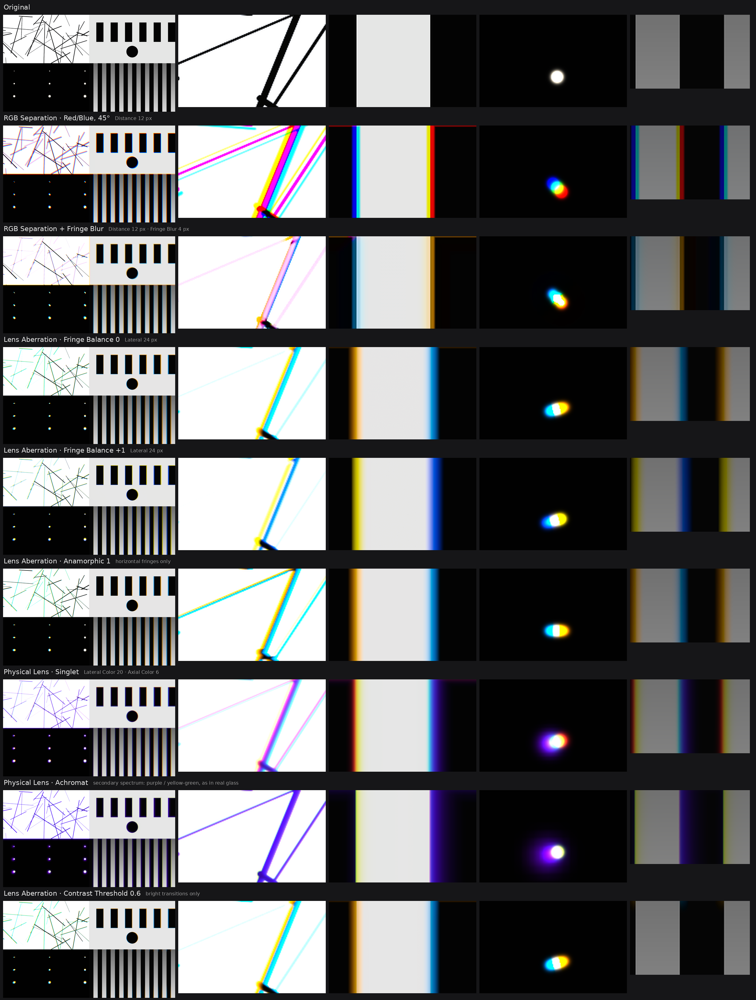

## Installation
Download the files for your host from the [latest release](https://github.com/Velich2/Chromatron/releases/latest),
close the host and copy them:

| Host | File | Folder |
|---|---|---|
| After Effects, Premiere Pro (Windows) | `Chromatron.aex` | `C:\Program Files\Adobe\Common\Plug-ins\7.0\MediaCore` |
| DaVinci Resolve (Windows) | `Chromatron.ofx.bundle` | `C:\Program Files\Common Files\OFX\Plugins` |
| DaVinci Resolve (macOS) | `Chromatron.ofx.bundle` | `/Library/OFX/Plugins` |
| DaVinci Resolve (Linux) | `Chromatron.ofx.bundle` | `/usr/OFX/Plugins` |

The effect appears in the **Chromatron** category. The After Effects / Premiere plug-in for macOS is not
published yet: it has to be built on a Mac with the After Effects SDK (see [Building](#building)).

GPU rendering with CUDA needs an NVIDIA GPU from the Turing generation (GTX 16xx, RTX 20xx) or newer and
driver R580 or newer. On older NVIDIA GPUs or drivers the effect renders on the CPU automatically; OpenCL and
Metal have no such limit.

## Modes
The examples are rendered with `chromatron_cli` from its synthetic test frame (1920×1080); each caption gives the
options: `chromatron_cli --synthetic 1920x1080 out.ppm <options>`.

| Original: bars (lens modes are strongest in this corner) | Original: point lights |
|---|---|
| 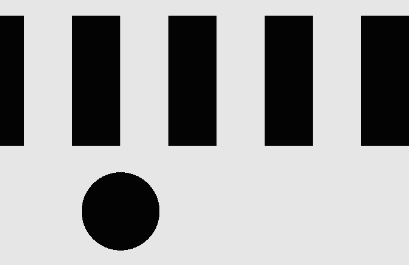 | 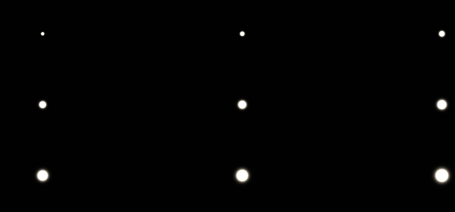 |

### RGB Separation
| Parameter | What it does |
|---|---|
| Color Pair | Red/Cyan, Green/Magenta, Blue/Yellow, Red/Blue (green stays in place) |
| Angle | direction in which the two channel groups move apart (in opposite directions) |
| Distance | distance between the groups, px |
| Spread | 0 – hard digital offset, 1 – soft prism-like smear of each group |

| `--mode sep --pair rb --distance 12 --angle 45` | the same with Fringe Blur, `--blur 4` |
|---|---|
| 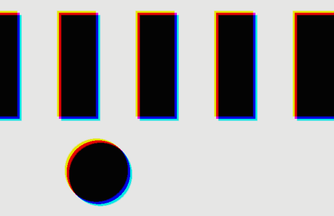 | 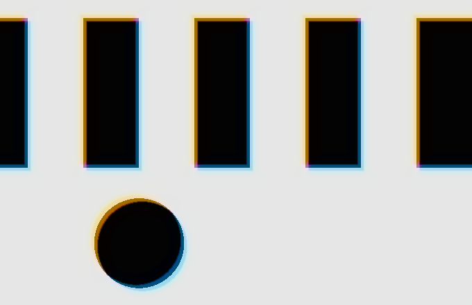 |

### Lens Aberration
Stylised lateral chromatic aberration: the spectrum (400–700 nm) is magnified around the optical centre, so the
effect grows towards the frame corners.

| Parameter | What it does |
|---|---|
| Lateral | spread of the spectrum at the frame corner, px; the sign swaps the warm and cool sides |
| Fringe Balance | −1 red-orange / cyan · 0 orange / teal · +1 golden / azure |

| `--mode abr --lateral 24` | Fringe Balance +1, `--balance 1` |
|---|---|
| 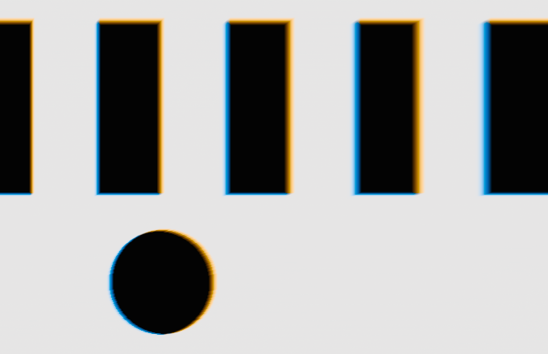 |  |

**No magenta, purple or muddy green.** Dispersion is monotonic along the spectrum, and the magenta↔green component
is removed from the chromatic part of the displacement (luminance preserved). Fringes stay on the warm/cool axis set
by Fringe Balance, thin lines included, where a plain spectral shift turns pink or green. Tests check this for every
Balance value and for ACES.

### Physical Lens
A model that follows the glass instead of a style: refractive index by Cauchy's equation (n − n₀ ∝ 1/λ²), a focal
shift per wavelength for the chosen lens correction, and the spectrum weighted by the CIE 1931 colour matching
functions. Lateral colour (each wavelength magnified differently) grows towards the corners; axial (longitudinal)
colour defocuses every wavelength but the focused one, equally over the whole frame – the purple halo of fast
lenses. Magenta and green fringes are not removed here: real glass shows them.

| Parameter | What it does |
|---|---|
| Correction | Singlet – uncorrected lens; Achromat – the F and C lines (486 / 656 nm) share a focus, the secondary spectrum (purple / green) remains; Apochromat – the d line (588 nm) shares it too |
| Lateral Color | spread of the spectrum at the frame corner, px (for a corrected lens: its residual spectrum) |
| Axial Color | defocus of the wavelength farthest from focus, px, over the whole frame |
| Focus Wavelength | wavelength in perfect focus, nm (550 – green, like most lenses) |

Lateral colour on the bars, then the three corrections with lateral and axial colour together
(`--lateral-color 20 --axial 6`). A singlet splits the spectrum blue against yellow; the secondary spectrum of an
achromat and an apochromat puts purple on one side of an edge and yellow-green on the other.

| Lateral Color only, `--mode phys --lateral-color 20 --axial 0` | Singlet, `--mode phys --lateral-color 20 --axial 6` |
|---|---|
| 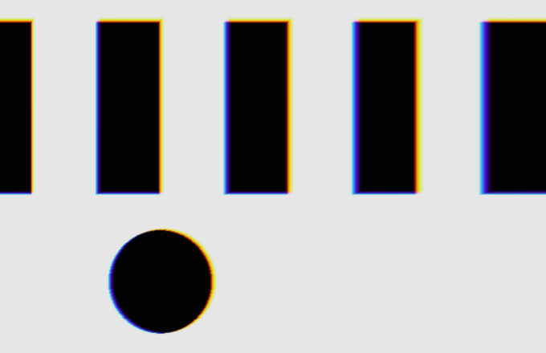 | 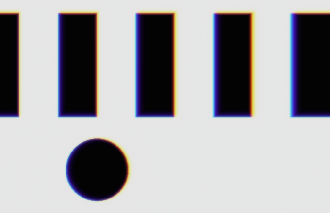 |
| **Achromat**, `... --correction achromat` | **Apochromat**, `... --correction apo` |
| 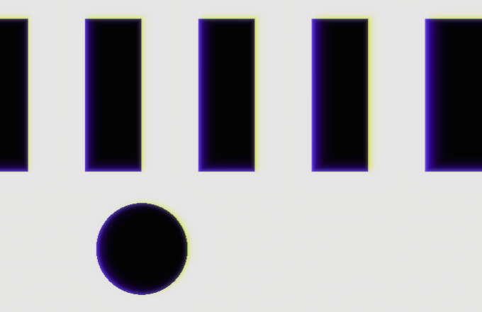 | 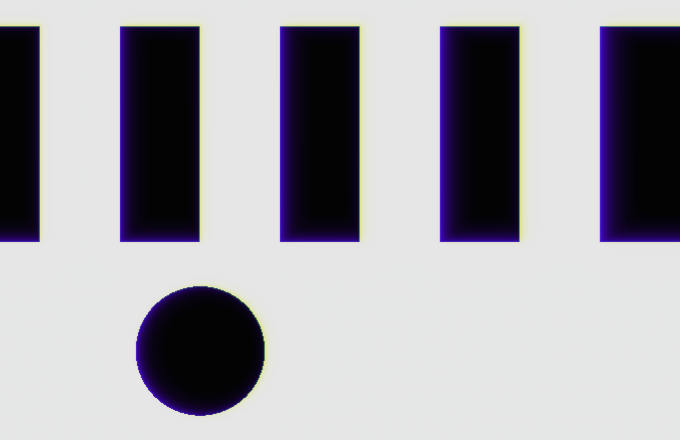 |

Axial colour on point lights (`--mode phys --lateral-color 0 --axial 10`): the colour of the halo is the part of
the spectrum that is out of focus. Focused on green, red and blue blur into a purple halo; focused on blue, the
halo is orange; focused on red, it is blue.

| Focus 550 nm (default) | Focus 450 nm, `--focus 450` | Focus 650 nm, `--focus 650` |
|---|---|---|
| 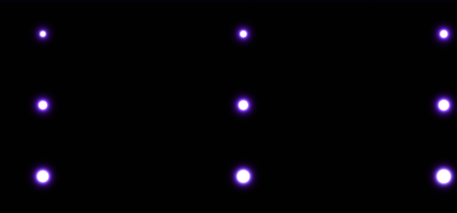 | 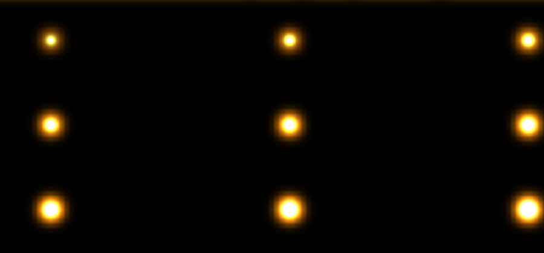 | 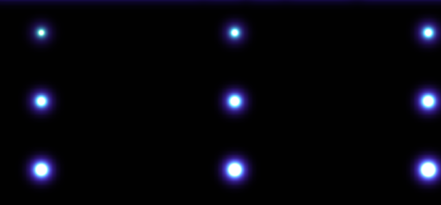 |

### Common
**Edge Mask** – every mode:

| Parameter | What it does |
|---|---|
| Contrast Threshold | 0 – everywhere; higher – only on increasingly strong light transitions (1.0 – HDR sources) |
| Threshold Softness | softness of the threshold |
| Show Mask | where fringes appear, in black and white: black – pixel unchanged, white – strong fringe. Includes the threshold, Mix and the growth towards the frame corners |

Whole frame, `--mode abr --lateral 24`:

| Contrast Threshold 0 | Contrast Threshold 0.6, `--threshold 0.6` | Show Mask, `--threshold 0.6 --show-mask` |
|---|---|---|
| 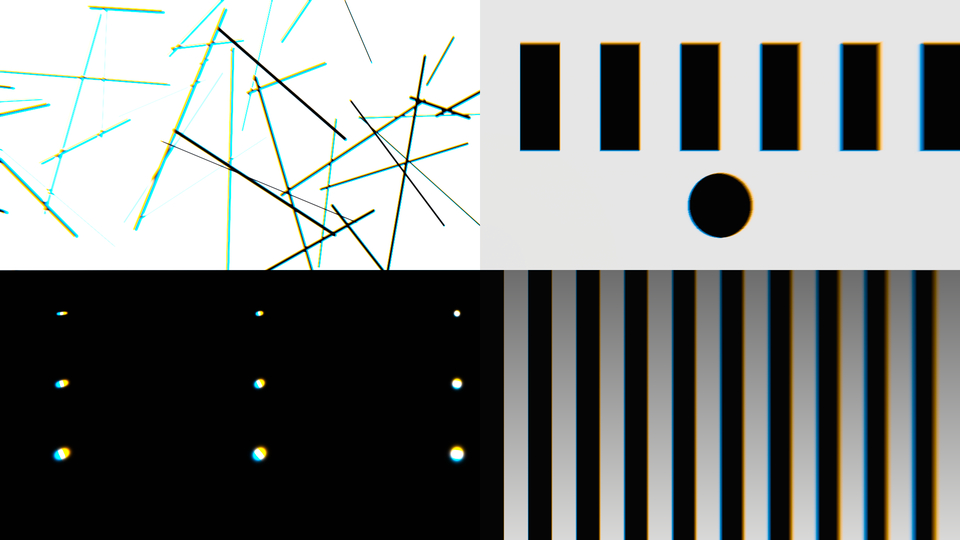 | 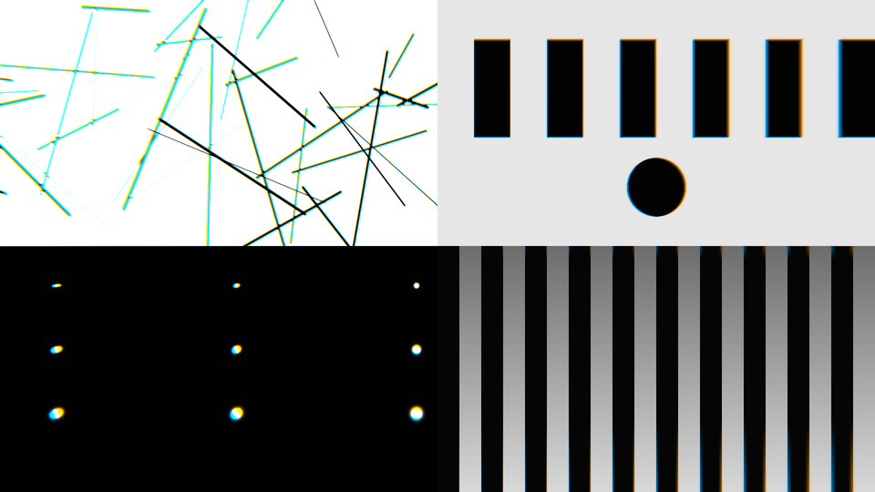 | 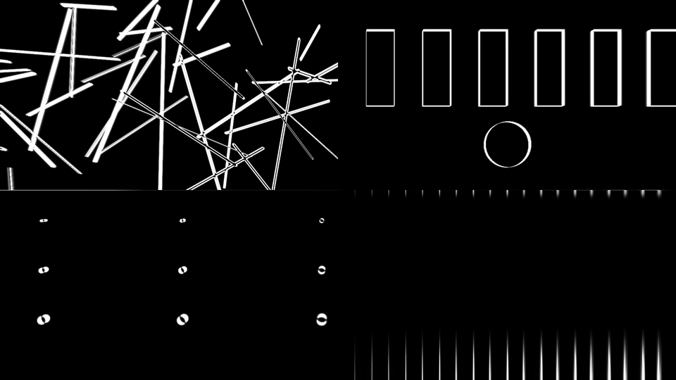 |

**Optics:**

| Parameter | What it does |
|---|---|
| Optical Center | optical axis (Lens Aberration and Physical Lens) |
| Falloff | how the lens modes grow from the optical centre: 1 – evenly, higher – a clean centre and strong corners. The fringe at the frame corner stays the same |
| Anamorphic | 0 – round lens; 1 – horizontal fringes only, as with an anamorphic lens; −1 – vertical only |
| Highlight Boost | stops of light restored to clipped highlights before the optics, so fringes glow out of them instead of tinting the white; 0 – off. For SDR and display-referred footage: HDR and scene-linear sources already carry their highlights |
| Fringe Saturation | strength of the fringe colour, independent of its width: 0 – no colour, 100 % – natural, 200 % – vivid |
| Fringe Blur | softens the colour of the fringes, px; luminance and image detail stay sharp. At values close to the fringe width the colour turns grey. Not available in Physical Lens, where Axial Color is the defocus |
| Mix | blend with the original |
| Use GPU | render on the GPU when the host provides one; off – on the CPU |
| Color Space | encoding of the input (see below), the last parameter in the list |

Highlight Boost on an SDR source: the synthetic frame saved as 8-bit, so the sky is clipped at white
(`chromatron_cli sdr.ppm out.ppm --mode phys --lateral-color 4 --axial 8`). Without the boost a fringe can only dim
the white next to it, and the sky turns yellow-green along the branches; with it the white stays clean and the
branches take the purple fringe of a real lens.

| Highlight Boost 0 | Highlight Boost 1, `--highlights 1` |
|---|---|
| 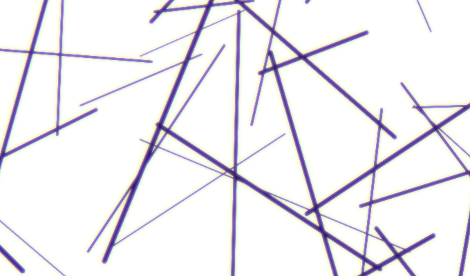 | 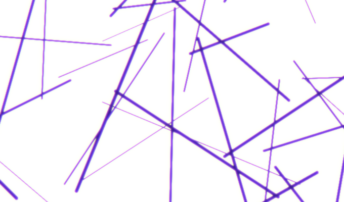 |

Falloff on the bars from the frame centre (left) to the edge (right), `--mode abr --lateral 30`:

| Falloff 1 | Falloff 3, `--falloff 3` |
|---|---|
| 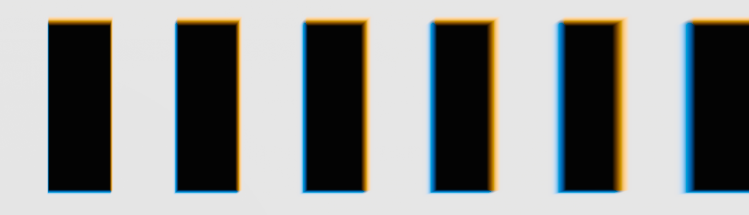 | 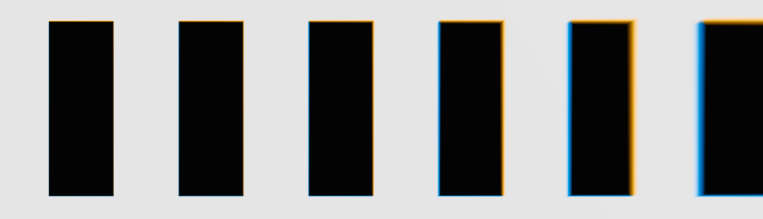 |

Anamorphic and Fringe Saturation, `--mode abr --lateral 24` (compare with the Lens Aberration example above):

| Anamorphic 1, `--anamorphic 1` | Fringe Saturation 50 %, `--saturation 0.5` | Fringe Saturation 200 %, `--saturation 2` |
|---|---|---|
| 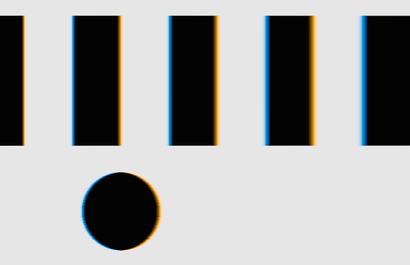 | 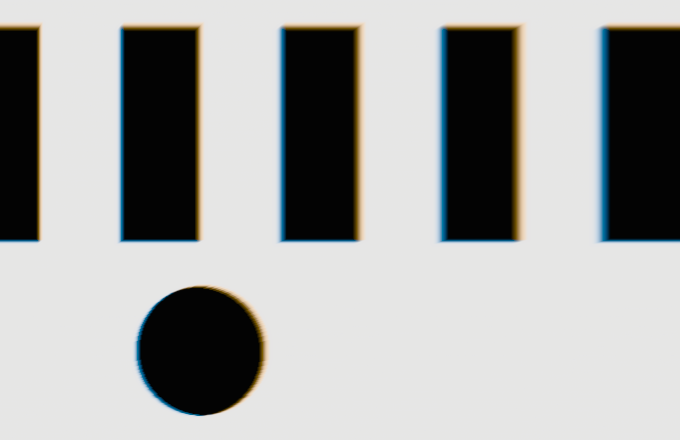 | 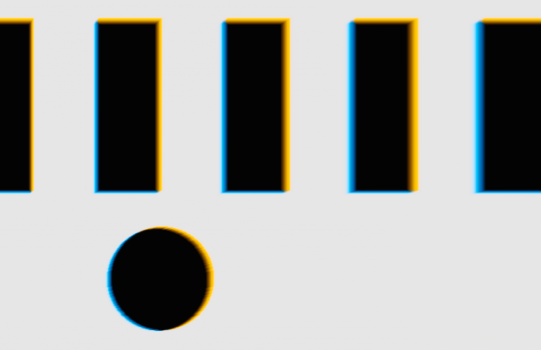 |

Each group ends with a **Reset** button that sets the group's parameters back to their defaults (Mode, Use GPU and
Color Space are not touched).

The number of spectral samples is automatic: 12 or more when neighbouring wavelengths would sit more than 1.25 px
apart; the remaining gaps are smoothed, so fringes never show banding.

## Colour and ACES
The optics always run on **linear light**. The *Color Space* parameter:

| Value | Processing |
|---|---|
| **Auto** (default; the last item in AE and in hosts that do not reorder lists) | Resolve/OFX: the colour space the host reports for the clip (OpenFX colour management), otherwise *Rec.709 Gamma 2.4*. After Effects: 32 bpc → *Linear*, 8/16 bpc → *sRGB*. Premiere Pro: *Rec.709 Gamma 2.4* |
| Linear (Rec.709 primaries) | as is |
| sRGB / Rec.709 Gamma 2.4 (BT.1886) | decode → linear Rec.709 → back (BT.1886 with zero black = power 2.4) |
| Rec.709 (Scene) | inverse BT.709 camera curve → linear Rec.709 → back |
| ACEScg | linear AP1 |
| ACEScct / ACEScc | decode → ACEScg (AP1) → back |
| ACES2065-1 (AP0) | AP0 → AP1 → back |
| DaVinci Wide Gamut / Intermediate | decode Intermediate → DWG → ACEScg (AP1) → back |
| DaVinci Wide Gamut (linear) | DWG → AP1 → back |

Wide gamuts (ACES, DaVinci Wide Gamut) are processed in AP1 with its luminance weights; the fringe axes are carried
from Rec.709 to AP1, so the hues are the same in any pipeline. The DWG↔AP1 matrix is derived from the DWG primaries
(Bradford D65→D60, the same way that yields the reference Rec.709→AP1).
A manual choice is only needed if Auto got it wrong. The exact curve hardly matters: the frame is decoded and
encoded back with the same curve, so an inaccuracy only changes how linear the optics are, not the colours of the
picture; colour spaces Auto does not know are put into their family (linear / gamma / log).
In Resolve: ACES project → *ACEScct*; DaVinci YRGB Color Managed with a wide gamut (DaVinci Wide Gamut /
Intermediate timeline) → *DaVinci Wide Gamut / Intermediate*; DaVinci YRGB without colour management →
*Rec.709 Gamma 2.4* (default); timeline or clip in "Rec.709 (Scene)" → *Rec.709 (Scene)*.
In After Effects: 8/16 bpc without linearisation → *sRGB*, linearised 32 bpc → *Linear*, OCIO/ACES → *ACEScg*.

## How it works
```
src/kernels/ChromatronKernels.h   single-source kernels: C++ / CUDA / OpenCL C / Metal
src/core/                         model: settings → spectral taps, blur pyramid, mask; pass sequence
src/backends/                     CPU (std::thread), CUDA (stream), OpenCL (cl_mem), Metal (MTLBuffer)
src/ofx/                          OpenFX plug-in (Resolve): CPU/CUDA/OpenCL/Metal as the host chooses
src/ae/                           After Effects: SmartFX, 8/16/32 bpc, GPU through PF_Cmd_SMART_RENDER_GPU;
                                  Premiere Pro: PF_Cmd_RENDER (BGRA 8u/32f on the CPU) and the xGPUFilterEntry GPU filter
tools/chromatron_cli.cpp          renders PPM/PFM through the same pipeline
tests/test_core.cpp               model invariants and OpenCL ↔ CPU parity
```
Passes per frame: import (colour decode, Highlight Boost expansion) → 3 levels of Gaussian blur → (mask: luminance →
local contrast → threshold → dilation) → spectral gather (magenta/green removal in Lens Aberration, Fringe
Saturation) → highlight compression and encode back.

## Building
Requires CMake ≥ 3.20 and C++17.

**Resolve / OFX** (Windows, macOS, Linux):
```
cmake -S . -B build -DCMAKE_BUILD_TYPE=Release
cmake --build build --config Release
cmake --install build      # Chromatron.ofx.bundle → OFX plug-in folder
```
The OpenFX SDK is downloaded automatically (tag `OFX_Release_1.5.1`) or set with `-DOFX_SDK_DIR=...`.
CUDA is built when the CUDA Toolkit is found (Windows/Linux); OpenCL when an OpenCL SDK is found; Metal on macOS.

**Windows in one command** – `build_windows.bat` (needs Visual Studio 2022 or 2026 with *Desktop development with
C++*, Git, optionally the CUDA Toolkit). The script finds Visual Studio and the After Effects SDK
(default `C:\Users\Velich\AfterEffectsSDK_26.5_win`, override with `AE_SDK_ROOT`), and the Premiere Pro SDK for GPU
rendering in Premiere (default `C:\Users\Velich\Premiere_Pro_24.0_C++_Win_SDK`, override with `PR_SDK_ROOT`;
without it Premiere renders the effect on the CPU). It builds AE and OFX in Release, runs the tests and installs
the plug-ins: `Chromatron.aex` into `C:\Program Files\Adobe\Common\Plug-ins\7.0\MediaCore`, `Chromatron.ofx.bundle`
into `C:\Program Files\Common Files\OFX\Plugins`. Run it from an administrator console with After Effects,
Premiere and Resolve closed:
```
build_windows.bat              :: build + tests + install
build_windows.bat noinstall    :: build and tests only
```

**After Effects** (Windows, macOS) – needs the After Effects SDK from Adobe (not redistributable):
```
cmake -S . -B build -DCHROMATRON_BUILD_AE=ON -DAE_SDK_DIR=/path/to/AfterEffectsSDK
cmake --build build --config Release
```
Output: `build/AfterEffects/Chromatron.aex` (Windows) or `Chromatron.plugin` (macOS).
GPU in AE: CUDA and OpenCL (Windows), Metal (macOS). If AE uses DirectX, the effect renders on the CPU.

**Premiere Pro** loads the same `.aex`. With `-DPR_SDK_DIR=/path/to/Premiere_Pro_SDK` the module also gets the
Premiere GPU filter (Mercury: CUDA, OpenCL with 32f and 16f frames, Metal). Without the Premiere SDK, with DirectX
acceleration or in Software Only mode the effect renders on the CPU through `PF_Cmd_RENDER`.

**Check:**
```
ctest --test-dir build
build/chromatron_cli --synthetic 1920x1080 out.ppm --mode abr --lateral 8 --blur 2 --threshold 0.5
build/chromatron_cli --synthetic 1920x1080 out.ppm --mode phys --correction achromat --lateral-color 10 --axial 3
```

## CI
GitHub Actions (`.github/workflows/build.yml`) builds and tests every PR on Linux (CPU + OpenCL on pocl), Windows
(CPU + CUDA + OpenCL) and macOS (CPU + Metal, universal). The OFX bundles for each platform are in the run
artifacts. After Effects is not built in CI: the Adobe SDKs cannot be put in the repository.

## Status
* Kernels and the CPU and OpenCL backends are covered by tests (OpenCL matches the CPU, float and 16-bit float
  frames, all three modes with and without the look controls); CI runs them on Linux, Windows and macOS.
* After Effects 2026 (Windows): rendering checked (CPU path, scripted renders).
* Premiere Pro (Windows): CPU rendering and the GPU filter checked.
* DaVinci Resolve (Windows): checked. The macOS and Linux bundles build and pass the tests in CI; they have not
  been checked inside Resolve on those systems yet.
